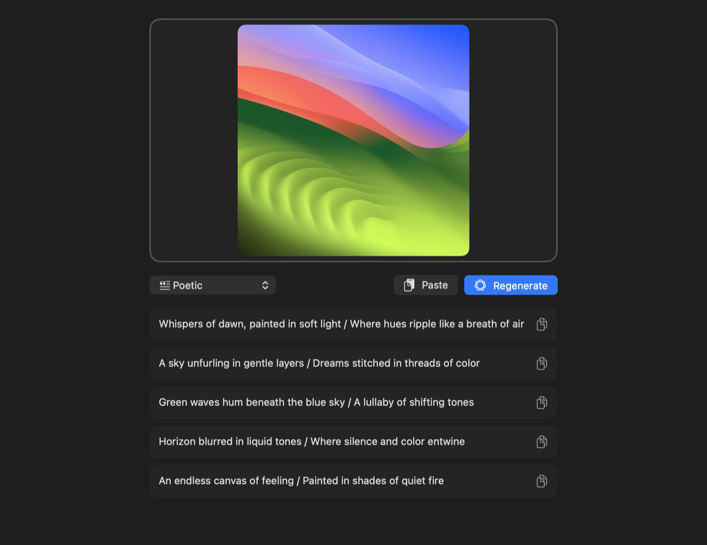

# Captioner

A small native macOS app that writes social-media captions for your photos using **Apple Intelligence**, entirely on-device.

Drop an image (or paste one from the clipboard), pick a style, and get five caption ideas you can copy with one click.

<p align="center">
  
</p>

## Features

- **Drag & drop** an image file, or **paste** with ⌘V (works with copied images and copied image files from Finder)
- **10 caption styles**: Funny, Thoughtful, Poetic, Minimal, Wholesome, Romantic, Nostalgic, Movie Trailer, Song Lyric Vibes, Pun
- **3 languages**: English, Simplified Chinese (简体中文) and Traditional Chinese (繁體中文). Your choice is remembered
- **Five suggestions per run**, with **Regenerate** (⌘↩) for a fresh batch. Changing the style regenerates automatically
- **Rotate** sideways photos 90° clockwise (⌘R); captions refresh for the new orientation
- **One-click copy** for each caption
- **Private**: uses Apple's on-device foundation model, so your photos never leave your Mac
- **Clear status messages** when Apple Intelligence is turned off, unsupported, or still downloading

### Example output

| Style | Caption |
|---|---|
| Funny | "Looks like someone had a color explosion" |
| Thoughtful | "Where do the edges end and the feeling begin?" |
| Poetic | "Columns of calm / beneath a painted sky." |
| Minimal | "soft light rhythm" |
| Movie Trailer | "A single hue. A single drop. The unraveling of the familiar." |
| Funny (繁體中文) | "這張圖的節奏，比我的早晨還混亂。" |
| Minimal (简体中文) | "光影的低语" |

## Requirements

- macOS 27 or later
- A Mac that supports Apple Intelligence (Apple silicon), with **Apple Intelligence turned on** in System Settings
- Swift 6.2+ toolchain. The Xcode **Command Line Tools** are enough; full Xcode is not required

## Build & run

```sh
git clone https://github.com/kosiew/captioner.git
cd captioner
./build-app.sh        # builds a release binary and packages Captioner.app
open Captioner.app
```

For development you can also run it directly:

```sh
swift run
```

`build-app.sh` builds with SwiftPM, wraps the binary in an `.app` bundle with an `Info.plist`, and ad-hoc code signs it. To use the app like any other, move `Captioner.app` to `/Applications`.

## How it works

```
 image (drop / paste)
        │
        ▼
 SystemLanguageModel.default ── supports vision? ──yes──► prompt + image attachment
        │                                                        │
        no                                                       │
        ▼                                                        │
 Vision framework: labels, faces, visible text                   │
        │                                                        │
        └──────► text description in prompt ─────────────────────┤
                                                                 ▼
                                    guided generation → { captions: [5 × String] }
```

1. The image is converted to a `CGImage`.
2. A `LanguageModelSession` is created with instructions specific to the chosen `CaptionStyle` and `CaptionLanguage`.
3. If the on-device model supports image input (`capabilities.contains(.vision)`), the image is attached to the prompt directly.
4. Otherwise the app falls back to the **Vision** framework (image classification, face detection, text recognition) and sends a text description instead.
5. **Guided generation** with a JSON-style schema makes the model return exactly five captions, so no fragile text parsing is needed.

### Why no `@Generable` / `@State`?

Those are Swift macros whose compiler plugins ship only with full Xcode. To keep the project buildable with just the Command Line Tools, the app uses:

- `DynamicGenerationSchema` instead of `@Generable`
- `ObservableObject` / `@StateObject` instead of `@Observable` / `@State`

If you have Xcode installed, you can switch to the macro versions.

## Project structure

```
Package.swift                         SwiftPM manifest (macOS 27+)
build-app.sh                          Builds and packages Captioner.app
scripts/make-icon.swift               Draws the app icon and writes Resources/AppIcon.icns
Resources/AppIcon.icns                Generated app icon
Sources/Captioner/
  CaptionerApp.swift                  App entry point and window setup
  ContentView.swift                   UI: drop zone, paste, style menu, caption list
  CaptionGenerator.swift              Caption styles, prompts, Apple Intelligence calls, Vision fallback
```

## App icon

The icon is drawn in code. To change it, edit `scripts/make-icon.swift` and run:

```sh
swift scripts/make-icon.swift   # regenerates Resources/AppIcon.icns and docs/icon.png
./build-app.sh
```

## Adding a caption style

Add a case to `CaptionStyle` in `Sources/Captioner/CaptionGenerator.swift` and provide:

- a display name (the raw value)
- an SF Symbol in `symbol`
- writing instructions in `guidance`

It appears in the style menu automatically.

## Adding a language

Add a case to `CaptionLanguage` in the same file, with a `displayName` (written in that language) and `guidance` telling the model to write in it. The on-device model supports around two dozen languages. `SystemLanguageModel.default.supportedLanguages` lists them.

## Troubleshooting

| Message | Fix |
|---|---|
| "Turn on Apple Intelligence in System Settings…" | System Settings → Apple Intelligence & Siri → turn it on |
| "The Apple Intelligence model is still downloading…" | Wait for the download to finish, then press Regenerate |
| "This Mac doesn't support Apple Intelligence." | Requires an Apple silicon Mac that supports Apple Intelligence |
| "The clipboard doesn't contain an image." | Copy an image (or an image file in Finder) before pasting |
| "Apple Intelligence didn't respond…" | The system model occasionally stalls. Captioner retries once automatically; press Regenerate to try again |

Because the app is ad-hoc signed, opening a copy built on another Mac may trigger Gatekeeper. Build it locally, or right-click → **Open**.

## License

[MIT](LICENSE)
